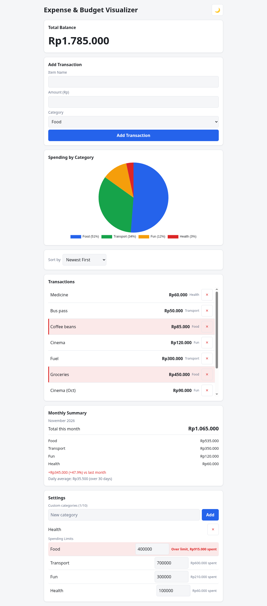
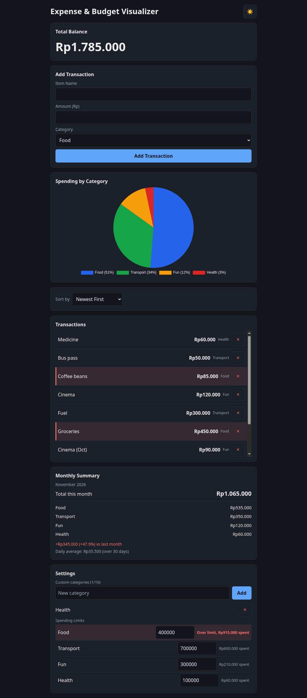
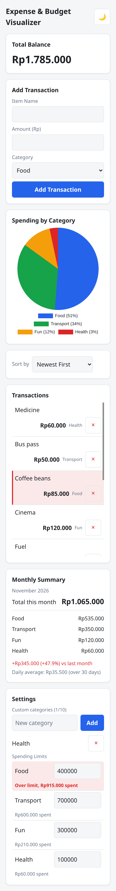

# Expense & Budget Visualizer

A single-page expense tracker built with plain HTML, CSS and JavaScript for the RevoU Coding Camp assignment.

**Author:** Albert Ricco Hideaki Yeo · 9 November 2026

**Live demo:** https://xxsansxv.github.io/CodingCamp-9November26-albertriccohideakiyeo/



## Features

### Core

- **Add transactions** — item name (up to 100 characters), amount, and category, with inline validation messages.
- **Total balance** — the sum of every transaction, updated as soon as a transaction is added or deleted.
- **Transaction list** — scrollable history, newest first by default, up to 100 entries rendered at a time, with a delete button per row.
- **Spending by category** — a Chart.js pie chart with a percentage legend and hover tooltips.
- **Data persistence** — transactions, categories, limits and preferences are stored in `localStorage`.
- **Storage error handling** — if saving or reading fails, a red banner explains what happened and the failed operation is rolled back instead of silently disappearing on reload.
- **Responsive** — works from 320px wide without horizontal scrolling; touch targets are at least 44px.

### Bonus (all five)

- **Dark mode** — toggle in the header, remembered across visits.
- **Sorting** — newest, oldest, highest amount, lowest amount, category A–Z, category Z–A. The choice is saved and restored on the next visit.
- **Custom categories** — add up to 10, trimmed and checked case-insensitively against duplicates; removable from the settings panel and available in the category dropdown.
- **Spending limits** — set a limit per category (0.01 – 999,999,999.99). When a category's total reaches or exceeds its limit, the limit row and every transaction in that category are highlighted, and the panel reports the amount spent.
- **Monthly summary** — current-month total, category breakdown, comparison with the previous month (amount and percentage), and average daily spending.

## Screenshots

| Dark mode | Mobile (320px) |
|---|---|
|  |  |

## Tech stack

- **HTML5** — semantic markup, no framework.
- **CSS3** — custom properties for theming, flexbox layout, one media query, no preprocessor.
- **JavaScript (ES2015+)** — no dependencies beyond Chart.js, no build step, no backend.
- **[Chart.js 4.6.1](https://www.chartjs.org/)** — loaded from jsDelivr (the rest of the app still works if the CDN is unreachable; the chart shows its empty state).
- **localStorage** — the only data store.

## Project structure

```text
.
├── index.html                  # Markup: header, form, chart, list, summary, settings
├── css/
│   └── style.css               # Theme variables, layout, components, responsive rules
├── js/
│   └── app.js                  # Constants, state, storage, operations, renderers, events
├── docs/
│   └── screenshots/            # Images used by this README
├── .kiro/
│   └── specs/expense-budget-visualizer/
│       ├── requirements.md     # Numbered acceptance criteria
│       ├── design.md           # Architecture and decisions
│       └── tasks.md            # Implementation checklist
└── README.md
```

## Run locally

No install or build step. Serve the folder over HTTP (opening `index.html` directly also works, but a local server matches GitHub Pages):

```bash
git clone https://github.com/xxsansxv/CodingCamp-9November26-albertriccohideakiyeo.git
cd CodingCamp-9November26-albertriccohideakiyeo
python3 -m http.server 8000
```

Then open <http://localhost:8000>.

## How data is stored

Everything lives in the browser under four `localStorage` keys:

| Key | Contents |
|---|---|
| `expense_transactions` | Array of `{ id, itemName, amount, category, timestamp }` |
| `expense_categories` | Array of custom categories `{ id, name, isDefault }` |
| `expense_limits` | Object mapping a category name to its limit, e.g. `{ "Food": 500000 }` |
| `expense_settings` | `{ theme, sortMethod }` |

Timestamps are local-time strings (`YYYY-MM-DDTHH:MM:SS`), so month grouping and sorting do not depend on the time zone.

## Implementation notes

- **Currency** is formatted with `Intl.NumberFormat('id-ID')` and an explicit `Rp` prefix, producing `Rp15.000` (no space, dot thousands separator).
- **Daily average** divides the current month's total by the calendar length of that month (30 for November 2026), not by elapsed days.
- **Spending limits** compare against a category's all-time total, as the requirements do not scope limits to a single month.
- **Monthly comparison** appears only when the previous month has at least one transaction; otherwise the summary shows “No previous month data”.
- **Rendering** is subscription-based: state operations persist and notify, then the renderers rebuild the balance, list, chart, limits and summary. Chart data is updated in place rather than recreated.
- **Validation** rejects amounts outside `0.01 – 9,999,999,999.99`, item names over 100 characters, and category names outside `1 – 50` characters.

## AI usage disclaimer

This project was completed with the help of AI tools. [Kiro](https://kiro.dev/) was used to produce the spec (`requirements.md`, `design.md`, `tasks.md`), and [OpenCode](https://opencode.ai/) was used for debugging and as a pair-programming assistant while I wrote the code. All implementation decisions and the final code were reviewed and are my responsibility.

## Credits

- [Chart.js](https://www.chartjs.org/) for the pie chart.
- RevoU Coding Camp for the brief and the learning materials.
